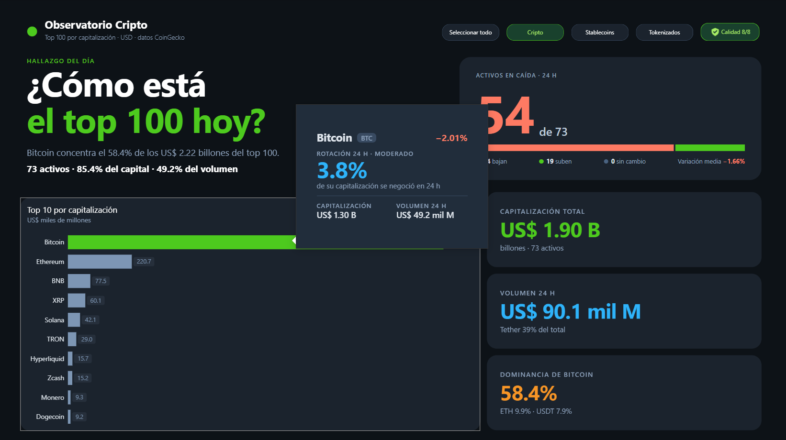
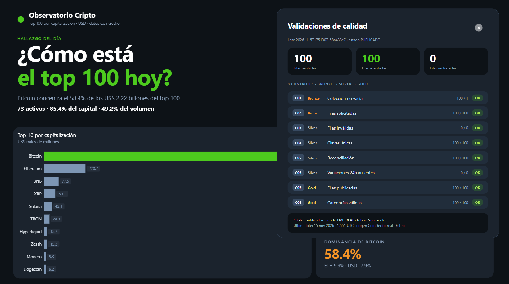
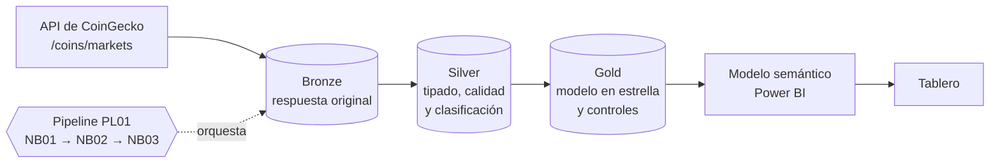

# 01 · Observatorio Cripto

Tablero de una página que responde **¿cómo está el top 100 de criptoactivos hoy?** Los datos se descargan de la API de CoinGecko, se procesan en un Lakehouse de Microsoft Fabric con arquitectura medallón (Bronze, Silver, Gold) y se muestran en Power BI. Incluye controles de calidad de datos visibles dentro del propio tablero.

> **Réplica adaptada** del caso *Snapshot diario de criptomonedas* de [Vicente Antonio Juan Magallanes](https://github.com/vicente2121/DATADAYS_DP600/tree/main/charla01/caso_01_snapshot_diario_criptomonedas).



*El tablero con la categoría Cripto seleccionada. Al pasar el cursor sobre una barra del ranking aparece el detalle del activo: variación, rotación diaria, capitalización y volumen. Sin categoría seleccionada, muestra el top 100 completo.*



*El panel de calidad, que se abre desde el botón «Calidad 8/8»: filas recibidas, aceptadas y rechazadas, y el resultado de los 8 controles del último lote.*

## Qué muestra el tablero
| Bloque | Contenido |
|---|---|
| Portada | Dominancia de Bitcoin y reparto de la capitalización entre Cripto, Stablecoins y Tokenizados |
| Segmentación | Filtro por categoría de activo; todo el tablero responde a él |
| Termómetro | Cuántos activos caen, suben o no cambian en 24 h, con la variación media. Al pasar el cursor muestra los 3 mayores movimientos por variación y por impacto en dólares |
| Tarjetas | Capitalización total, volumen de 24 h y dominancia de Bitcoin. Al pasar el cursor se voltean y explican el indicador |
| Ranking | Top 10 por capitalización. Al pasar el cursor sobre una barra aparece su rotación diaria (volumen ÷ capitalización) |
| Panel de calidad | Resultado de los 8 controles de calidad del último lote, con filas recibidas, aceptadas y rechazadas |

## Arquitectura


| Capa | Notebook | Qué hace |
|---|---|---|
| Bronze | `NB01_CoinGecko_Bronze` | Consulta la API, guarda la respuesta original en JSON y en una tabla Delta |
| Silver | `NB02_CoinGecko_Silver` | Tipa y valida los datos, separa filas aceptadas y rechazadas, y clasifica cada activo en Cripto, Stablecoins o Tokenizados con las categorías de la API |
| Gold | `NB03_CoinGecko_Gold` | Publica el modelo en estrella y el resultado de los controles, y solicita el refresco del modelo semántico |

El pipeline `PL01_CoinGecko_Diario` encadena los tres notebooks y envía un correo si una etapa falla.

## Modelo semántico
Esquema en estrella en modo **Importar**, con origen en el punto de conexión SQL del Lakehouse.

| Tipo | Tablas |
|---|---|
| Dimensiones | `dim_activo`, `dim_fecha`, `dim_lote`, `dim_control` |
| Hechos | `fact_mercado_actual`, `fact_ejecuciones`, `fact_controles_actuales` |
| Medidas | Más de 30 medidas DAX en la tabla `_Measures`, ordenadas en carpetas (Mercado, Termómetro, Concentración, Ranking, Textos y HTML, Calidad), todas con descripción |

## Controles de calidad
| Código | Capa | Control |
|---|---|---|
| C01 | Bronze | Colección no vacía |
| C02 | Bronze | Filas solicitadas |
| C03 | Silver | Filas inválidas |
| C04 | Silver | Claves únicas |
| C05 | Silver | Reconciliación |
| C06 | Silver | Variaciones de 24 h ausentes |
| C07 | Gold | Filas publicadas |
| C08 | Gold | Categorías válidas |

## Estructura de la carpeta
```
01_CoinGecko/
├── README.md
├── fabric/             Elementos de Fabric sincronizados con Git (no editar a mano)
│   ├── 00_Data/        Lakehouse LH01_ObservatorioCripto
│   ├── 01_Pipeline/    Notebooks y pipeline
│   ├── 02_Model/       Modelo semántico (formato TMDL)
│   └── 03_Report/      Informe (formato PBIR)
├── notebooks/          Los 3 notebooks en formato .ipynb, listos para importar
├── docs/               Capturas del tablero
└── powerbi/
    ├── PBI_CoinGecko.pbix
    ├── paleta_colores.json
    └── iconos/         Iconos del tablero (PNG y SVG)
```

## Cómo replicarlo en tu entorno
1. **Espacio de trabajo.** Crea uno en Microsoft Fabric con capacidad (sirve la prueba gratuita).
2. **Lakehouse.** Crea un Lakehouse llamado `LH01_ObservatorioCripto` con **esquemas habilitados**.
3. **Notebooks.** En el espacio de trabajo, importa los tres archivos de `notebooks/`. Abre cada uno y asocia tu Lakehouse como predeterminado: el enlace al Lakehouse del autor no se incluye.
4. **Ejecución.** Ejecuta en orden Bronze, Silver y Gold. El último paso de Gold busca un modelo semántico llamado `PBI_CoinGecko` en el mismo espacio de trabajo, así que fallará mientras ese modelo no exista. Las tablas ya estarán escritas.
5. **Informe.** Abre `powerbi/PBI_CoinGecko.pbix` en Power BI Desktop. En *Transformar datos → Configuración del origen de datos → Cambiar origen*, escribe el punto de conexión SQL de tu Lakehouse y el nombre `LH01_ObservatorioCripto`. Actualiza y publícalo en tu espacio de trabajo con el nombre `PBI_CoinGecko`.
6. **Visual HTML Content.** El tablero lo usa para la portada, el termómetro, las tarjetas, el panel de calidad y el tooltip. Instálalo desde AppSource (*Obtener más visuales*), en su edición Regular.
7. **Pipeline (opcional).** `fabric/01_Pipeline/PL01_CoinGecko_Diario.DataPipeline` usa una conexión de Outlook y un correo de destino que debes sustituir por los tuyos.

Como alternativa, puedes conectar tu espacio de trabajo a una copia (fork) de este repositorio con la integración Git de Fabric y la carpeta `01_CoinGecko/fabric`. Al hacerlo, tendrás que volver a asociar el Lakehouse en los notebooks.

## Diseño
La paleta de colores está documentada, por elemento, en [`powerbi/paleta_colores.json`](powerbi/paleta_colores.json). Los iconos están en [`powerbi/iconos/`](powerbi/iconos/).

## Datos y recursos
- Datos obtenidos de la [API de CoinGecko](https://www.coingecko.com/en/api), sujeta a sus términos de uso.
- Los iconos proceden de [SVG Repo](https://www.svgrepo.com); cada uno conserva la licencia indicada en su página.
- Proyecto personal con fines educativos. No es asesoría financiera ni está afiliado a CoinGecko; su paleta se inspira en la identidad visual de esa marca.
