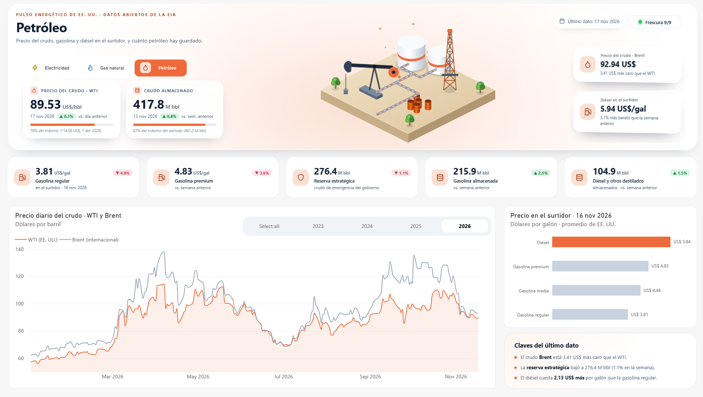
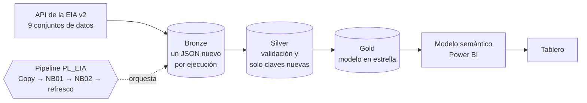

# 02 · Pulso Energético de EE. UU.

Tablero de una página que responde **¿cómo están hoy la electricidad, el gas natural y el petróleo en Estados Unidos?** Los datos salen de la API abierta de la EIA (Administración de Información Energética de EE. UU.), se cargan en un Lakehouse de Microsoft Fabric con una **carga histórica acumulativa (append)** y arquitectura medallón (Bronze, Silver y Gold), y se muestran en Power BI. Un selector de tres sectores cambia todo el tablero, y un panel de frescura indica si las 9 tablas están al día.

> **Réplica adaptada** del caso *Histórico de precios de combustibles* de [Vicente Antonio Juan Magallanes](https://github.com/vicente2121/DATADAYS_DP600/tree/main/charla02/caso_02_historico_precios_combustibles).



*El tablero con el sector Petróleo seleccionado: precio del WTI y del Brent, crudo almacenado, precios en el surtidor e inventarios. El banner, los indicadores, el gráfico y las barras cambian al elegir Electricidad o Gas natural.*

## Qué muestra el tablero
| Bloque | Contenido |
|---|---|
| Selector de sector | Electricidad, Gas natural o Petróleo; todo el tablero responde a él |
| Banner | Ilustración isométrica animada del sector, título, fecha del último dato y dos indicadores principales con su variación y su avance frente al máximo del período |
| Tarjetas laterales | Dos datos complementarios: fuente principal y región con más consumo, gas usado para generar electricidad, Brent y diésel |
| Indicadores | Cinco indicadores del sector. Al pasar el cursor se voltean y explican el término (Henry Hub, WTI, reserva estratégica…) |
| Gráfico diario | Serie diaria desde enero de 2023: consumo eléctrico frente al pronóstico, precio Henry Hub o WTI y Brent, con filtro por año |
| Barras | Con qué se generó la electricidad, en qué se consumió el gas o el precio de cada combustible en el surtidor; la barra mayor va en el color del sector |
| Claves | Tres frases que resumen el último dato |
| Panel de frescura | Se abre desde el botón «Frescura 9/9»: último dato de cada tabla Silver y si está al día según su frecuencia |

## Arquitectura


| Capa | Elemento | Qué hace |
|---|---|---|
| Bronze | Pipeline `PL_EIA` (actividad Copy) | Lee la clave de la API desde un archivo del Lakehouse y descarga, con paginación, la historia desde el 1 de enero de 2023 de los 9 conjuntos de datos. Cada ejecución escribe un archivo JSON nuevo y conserva los anteriores |
| Silver | `NB01_EIA_Silver` | Lee todos los archivos de Bronze, tipa y valida las observaciones, quita duplicados y agrega a cada tabla solo las claves que aún no existen |
| Gold | `NB02_EIA_Gold` | Reconstruye el modelo en estrella: dimensiones de fecha, región, fuente y serie, y hechos diarios, semanales y mensuales, con validaciones de claves y relaciones |

El pipeline `PL_EIA` encadena la extracción, los dos notebooks, la actualización del punto de conexión SQL y el refresco del modelo semántico. Tiene un correo de aviso por cada etapa que falla y uno de éxito al terminar.

### Carga histórica acumulativa (append)
- **Bronze no se sobrescribe.** Cada ejecución descarga la historia completa y la guarda en un archivo nuevo con la fecha y hora en el nombre.
- **Silver solo agrega.** Lee todos los archivos y, para cada clave natural (por ejemplo, serie y fecha), conserva el primer valor recibido. Inserta únicamente las claves nuevas con `MERGE`, así que volver a ejecutar no duplica datos.
- **Días incompletos.** La EIA publica la electricidad del día en curso incompleta, por eso Silver solo acepta días con al menos dos días de antigüedad.
- **Gold se reconstruye completo** en cada ejecución a partir de Silver.

### Datos que se extraen
| Sector | Conjunto de datos | Frecuencia |
|---|---|---|
| Electricidad | Demanda, pronóstico, generación e intercambio por región (US48 y 7 operadores de la red) | Diaria |
| Electricidad | Generación por fuente | Diaria |
| Electricidad | Intercambio entre regiones | Diaria |
| Petróleo | Precio spot del crudo WTI y Brent | Diaria |
| Petróleo | Precio de gasolina y diésel en el surtidor | Semanal |
| Petróleo | Inventarios de crudo, reserva estratégica, gasolina y destilados | Semanal |
| Gas natural | Precio Henry Hub, spot y futuro | Diaria |
| Gas natural | Gas en almacenamiento subterráneo por región | Semanal |
| Gas natural | Consumo por sector | Mensual |

## Modelo semántico
Esquema en estrella en modo **Importar**, con origen en el punto de conexión SQL del Lakehouse.

| Tipo | Tablas |
|---|---|
| Dimensiones | `dim_fecha`, `dim_region_electrica`, `dim_fuente_generacion`, `dim_serie` |
| Hechos | `fact_electricidad_diaria`, `fact_generacion_diaria`, `fact_intercambio_diario`, `fact_precios_diarios`, `fact_precio_combustible_semanal`, `fact_inventarios_semanales`, `fact_consumo_gas_mensual`, `fact_precios_mensuales`, `fact_ultimo_precio` |
| Auxiliares | `Sector` (selector), `Categoría de barras` y `Serie del gráfico` (parámetro de campo) |
| Medidas | 119 medidas DAX en la tabla `Medidas`, ordenadas en carpetas (Sector, Electricidad, Gas natural, Petróleo, Gráficos, Frescura y HTML), todas con descripción |

## Validaciones y frescura
| Capa | Validación |
|---|---|
| Silver | Descarta observaciones sin fecha, sin valor o sin clave completa, y valores menores o iguales a cero donde no tienen sentido |
| Silver | Excluye los días de electricidad todavía incompletos |
| Silver | Ninguna clave natural repetida y particiones por año y mes |
| Gold | Ninguna tabla vacía y ninguna clave repetida en dimensiones ni en hechos |
| Gold | Ningún valor de un hecho sin su fila en la dimensión |
| Gold | Las observaciones del resumen mensual suman exactamente las filas de precios de Silver |
| Tablero | Panel de frescura: cada tabla está al día si su último dato tiene hasta 7 días (diaria), 14 (semanal) o 120 (mensual) |

## Estructura de la carpeta
```
02_EIA/
├── README.md
├── fabric/             Elementos de Fabric sincronizados con Git (no editar a mano)
│   ├── 00_Data/        Lakehouse LH_EIA
│   ├── 01_Pipeline/    Notebooks y pipeline
│   ├── 02_Model/       Modelo semántico (formato TMDL)
│   └── 03_Report/      Informe (formato PBIR)
├── notebooks/          Los 2 notebooks en formato .ipynb, listos para importar
├── docs/               Captura del tablero
└── powerbi/
    ├── PBI_EIA.pbix
    ├── paleta_colores.json
    └── iconos/         Iconos del tablero (PNG y SVG)
```

## Cómo replicarlo en tu entorno
1. **Clave de la API.** Regístrate gratis en [EIA Open Data](https://www.eia.gov/opendata/register.php) para recibir tu clave por correo.
2. **Espacio de trabajo.** Crea uno en Microsoft Fabric con capacidad (sirve la prueba gratuita).
3. **Lakehouse.** Crea un Lakehouse llamado `LH_EIA` con **esquemas habilitados**. En *Files*, crea la carpeta `config` y sube un archivo `eia_config.json` con el contenido `{"api_key": "TU_CLAVE"}`. La clave no se guarda en el pipeline ni en los notebooks.
4. **Conexión.** Crea una conexión REST anónima con la URL base `https://api.eia.gov/`.
5. **Notebooks.** Importa los dos archivos de `notebooks/`. Abre cada uno y asocia tu Lakehouse como predeterminado: el enlace al Lakehouse del autor no se incluye.
6. **Pipeline.** Crea el pipeline `PL_EIA` con la definición de `fabric/01_Pipeline/PL_EIA.DataPipeline`. Cambia la conexión REST, los notebooks, el punto de conexión SQL, el modelo semántico, la conexión de Outlook y el correo de destino por los tuyos. Ejecútalo: la primera vez descarga toda la historia desde 2023.
7. **Informe.** Abre `powerbi/PBI_EIA.pbix` en Power BI Desktop. En *Transformar datos → Configuración del origen de datos → Cambiar origen*, escribe el punto de conexión SQL de tu Lakehouse y el nombre `LH_EIA`. Actualiza y publícalo en tu espacio de trabajo con el nombre `PBI_EIA`.
8. **Visual HTML Content.** El tablero lo usa para el banner, las tarjetas, los indicadores, las claves y el panel de frescura. Instálalo desde AppSource (*Obtener más visuales*), en su edición Regular.

Como alternativa, puedes conectar tu espacio de trabajo a una copia (fork) de este repositorio con la integración Git de Fabric y la carpeta `02_EIA/fabric`. Al hacerlo, tendrás que volver a asociar el Lakehouse en los notebooks y las conexiones del pipeline.

## Diseño
La paleta de colores está documentada, por elemento y por sector, en [`powerbi/paleta_colores.json`](powerbi/paleta_colores.json). Los iconos están en [`powerbi/iconos/`](powerbi/iconos/).

## Datos y recursos
- Datos obtenidos de la [API abierta de la EIA](https://www.eia.gov/opendata/) (U.S. Energy Information Administration), de dominio público.
- Los iconos de los sectores y de frescura se basan en [Lucide](https://lucide.dev) (licencia ISC). El icono de cerrar procede de [SVG Repo](https://www.svgrepo.com) y conserva la licencia indicada en su página.
- Proyecto personal con fines educativos. No está afiliado a la EIA.
